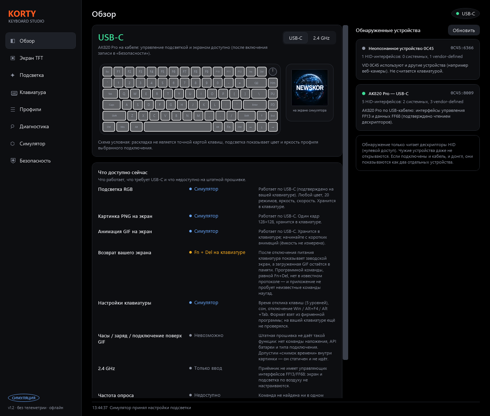

# KORTY Keyboard Studio

**A free, offline Windows app for the AJAZZ AK820 Pro:** RGB lighting, custom images and GIFs on the TFT screen, key response time, sleep time and key disables — without the vendor software.

[Русская версия (основная) → README.md](README.md)



> Unofficial project, not affiliated with AJAZZ. It talks to the keyboard over USB HID using the same commands as the community web configurator [kabelklaus/ajazz-ak820-pro](https://github.com/kabelklaus/ajazz-ak820-pro). **Use at your own risk** (see [Safety](#safety)). Confirmed working on a real AK820 Pro in USB mode: RGB, PNG and GIF upload.

## Features

- **Lighting** — any colour (palette, HSV, HEX, saved "My colours"), all 20 firmware effects, brightness, speed, direction, one-click presets, and a live approximate preview (click keys or type to see Key-on / Ripple reactions).
- **TFT screen** — layer editor (images, GIFs, text), animated background generator, preview "as the screen shows it" (RGB565 + dithering), library, PNG and GIF upload.
- **Keyboard settings** — **key response time in 5 levels** (with the vendor's timings and descriptions), sleep time (never / 1 / 5 / 30 min), disabling the Win key / Alt+F4 / Alt+Tab **inside the keyboard** (works without KORTY running).
- **Example animation** — a ready 24-frame KORTY GIF (`examples/korty-24frames.gif`, button *Example: KORTY 24 frames* on the Screen page) to test the upload.
- **Profiles** — separate USB / 2.4 GHz profiles, saved between runs.
- **Diagnostics** — detects the keyboard and the 2.4 GHz receiver, read-only snapshots, log, report export.
- No accounts, no telemetry, no network access, no admin rights.

## Download and run

1. Download the latest ZIP from **Releases**, unpack it anywhere.
2. Run `KORTY.KeyboardStudio.exe` (self-contained, no .NET install needed). For a Desktop/Start-menu shortcut run `Create-Shortcut.ps1` (right-click → Run with PowerShell).
3. Close the vendor software and any browser tab with a web configurator (they hold the device open).
4. Connect the keyboard with a **USB-C data cable** in **USB mode**. The sidebar shows "USB-C".
5. First use: press **"Enable keyboard control"** (Overview, Lighting, Screen or Safety page) and confirm once. Nothing is sent before that.

## Using it

| Goal | Where |
|------|-------|
| Change colour/effect | **Lighting** → pick preset/effect/colour → *Apply to keyboard* |
| Put a picture or GIF on the screen | **Screen TFT** → *＋ Photo/GIF* (or *Create background*) → *Prepare plan* → *Send to screen*. Start with short GIFs (≤ 10 frames); capacity has not been measured |
| Get your GIF back after the keyboard was unplugged | Press **Fn + Del** on the keyboard (it switches between the factory screen and your stored GIF) |
| Key response time / sleep / key disables | **Keyboard** page (tip: for the first try apply the same values the vendor software currently shows) |

Settings sent to the keyboard are stored **in the keyboard**. KORTY does not need to run afterwards, and **autostart is not needed**.

## What the firmware cannot do (honest limits)

- **No clock, battery or connection icons on top of your GIF.** The known protocol has no overlay command and no battery/connection API; the clock is shown by the *factory* screen. You can burn a static "time snapshot" into a picture, but it does not tick.
- **No software equivalent of Fn+Del found.** No known command selects the screen; KORTY never tries unknown commands.
- **2.4 GHz receiver is input-only** — it exposes no control interfaces, so lighting and screen cannot be changed wirelessly.
- **Key response time and the settings block are not yet confirmed on hardware.** The byte layout was recovered by static analysis of the vendor software (nothing was executed) — see [docs/PROTOCOL_RESEARCH.md](docs/PROTOCOL_RESEARCH.md). Note: the community web configurator labels the same byte "standby"; per the vendor software it is the key response level.
- Clock sync is not offered (the factory screen clock is not a priority).
- Polling rate, reset and factory reset are intentionally not offered.

## Safety

Writes are only possible after you enable keyboard control, and only to a **VID 0C45 / PID 8009** device whose HID descriptors match exactly (control interface `FF13`, 65-byte feature reports; data interface `FF68`, 4097-byte output reports). Every command is checked against a fixed list before it is sent; reset, firmware, key remapping, macros, polling rate and unknown commands are blocked permanently. Discovery only reads descriptors and never opens foreign devices. Details: [docs/SECURITY_AUDIT.md](docs/SECURITY_AUDIT.md). Other keyboard revisions are refused rather than guessed.

## How to help

- **Compatibility reports** — *Diagnostics → Export report* contains no serial numbers or device paths. Attach it to an issue if your keyboard is not recognised.
- **Hardware reports for the Keyboard page** — tell us in an issue whether applying key response / sleep / key disables worked on your keyboard.
- **Other missing settings** — capture the USB traffic of the vendor software while it changes the setting (e.g. with USBPcap + Wireshark) and attach the `.pcapng` to an issue. Only publish captures you are comfortable sharing.

## Build from source

Requires the .NET 8 SDK (Windows).

```powershell
.\Run-Tests.ps1          # unit, golden-vector, fake-device and UI-logic tests
.\Run-Studio.ps1         # build and run (add -Simulate to run without hardware)
.\Build-Release.ps1      # self-contained single-file EXE + ZIP in .\release
```

Layout: `src\Korty.Core` (protocol, safety gate, models) · `src\Korty.Rendering` (images/GIF/compositor) · `src\Korty.Hid.Windows` (HID access) · `src\Korty.App` (WPF UI) · `src\Korty.Diag` (read-only CLI) · `tests`. Architecture: [docs/ARCHITECTURE.md](docs/ARCHITECTURE.md). Protocol notes: [docs/PROTOCOL_RESEARCH.md](docs/PROTOCOL_RESEARCH.md) (Russian).

## Credits and license

MIT — see [LICENSE](LICENSE). The keyboard protocol was implemented independently from the behaviour of kabelklaus/ajazz-ak820-pro (MIT); see [THIRD_PARTY_NOTICES.md](THIRD_PARTY_NOTICES.md). Thanks also to the authors of wsclx/ak820pro-modder for protocol documentation. Windows may show a SmartScreen warning for unsigned downloads; the key-blocking option uses a standard low-level keyboard hook, which some antivirus tools flag heuristically — the source is here to inspect.
